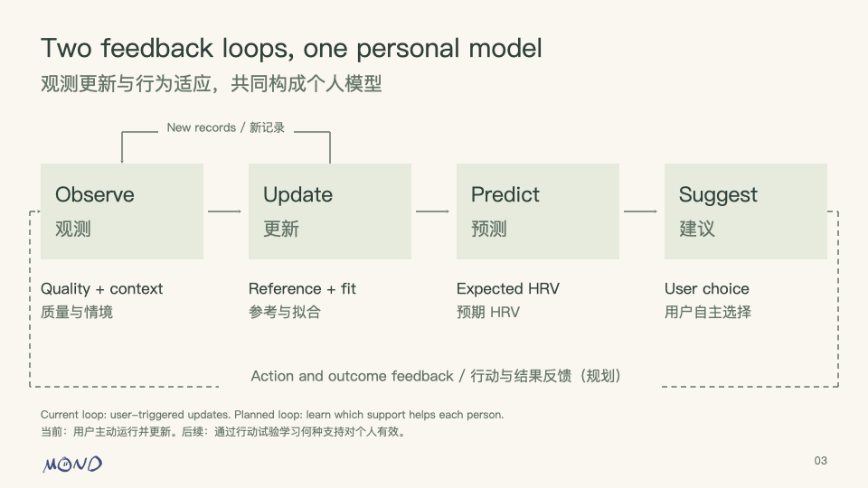

# MOND: Personal HRV as a Complex Adaptive System
# MOND：个人 HRV 的复杂适应系统

**Model / 模型版本:** `mond-lab-1.1.0`  
**Date / 日期:** 5 November 2026 / 2026 年 11 月 5 日  
**Deck / 演示文稿:** [Bilingual presentation / 中英双语 PPT](MOND_Adaptive_System_EN_ZH.pptx)



## 1. System framing / 系统定位

MOND treats personal physiology, daily context, user choices and feedback as an interconnected adaptive system. A reading captures part of that system. Individual history and information available at the time determine how the model interprets it.

MOND 将个人生理、日常情境、用户选择与反馈视为相互关联的适应系统。一次测量只能反映系统的局部状态；个人历史与当时已知的信息共同决定如何解释它。

| System property / 系统特征 | Product implication / 产品含义 |
|---|---|
| Coupled influences / 多因素相互作用 | Consider sleep, activity, resting heart rate and optional cycle context together. / 联合考虑睡眠、活动、静息心率及可选周期背景。 |
| Multiple timescales / 多时间尺度 | Distinguish the recording, recent deviation and longer personal reference. / 区分单次记录、近期偏移与长期个人参考。 |
| Individual histories / 个体历史 | Compare each person with their comparable past. / 与本人可比条件下的历史比较。 |
| Feedback and adaptation / 反馈与适应 | Update with new records, then test whether recommendations help. / 随新记录更新，再通过试验检验建议是否有益。 |

**Current implementation:** a configurable decay autoregression with optional ridge fitting, chronological backtesting and separate suggestion rules. New inputs and explicit reruns refresh the estimate. The wider complex adaptive system is the architectural framing. Nonlinear interactions, latent-state inference and causal action-response learning remain future work.

**当前实现：**可调的衰减自回归、可选岭回归拟合、时间滚动回测，以及独立的建议规则。新增输入后主动运行即可更新估计。“复杂适应系统”描述总体架构；非线性耦合、隐状态推断与因果行动响应学习仍属后续工作。

## 2. Predictive core / 预测内核

```text
y = ln(RMSSD in ms)
ŷ = μ + exp(−Δt / τ) × (y_latest − μ) + Σ βj × (xj − referencej)
Displayed RMSSD / 展示值 = exp(ŷ)
```

| Term / 项 | Meaning / 含义 |
|---|---|
| `μ` | Personal reference on the log scale. / 对数尺度上的个人参考。 |
| `Δt` | Hours from the latest eligible measurement to the target. / 最近一次合格测量至目标时点的小时数。 |
| `τ` | Persistence time constant, default 48 h. / 控制近期偏移保留程度的时间常数，默认 48 小时。 |
| `xj` | Context already known at the prediction origin. / 预测时点已经知道的背景。 |
| `βj` | Manual or personally fitted coefficients, zero by default. / 手动设置或个人数据拟合的系数，默认零。 |

The displayed value is a median-form estimate on the original RMSSD scale. Default target: 24 hours after the prediction origin. Missing enabled features can make the full model unavailable; the page shows available simpler alternatives. A manually supplied reference supports a hypothetical scenario.

展示值是转换回 RMSSD 尺度的中位数形式估计，默认目标为预测时点之后 24 小时。启用的背景变量缺失时，完整模型可能无法运行，页面会显示可用的简单对照。手动参考值用于假设情景实验。

**Comparable history:** 28-day window, local clock time ±2 h, same user/device/modality/algorithm/recording conditions, each date equally weighted, current day excluded. Initial comparison requires 7 valid dates and the more mature label 14. These adjustable engineering defaults do not establish scientific validity.

**可比历史：**最近 28 天、当地时段前后 2 小时、同用户与设备及采集方式，每个日期等权并排除当天。7 个有效日期开放初步比较，14 个日期标记较成熟参考。这些是可调工程默认值，不能证明科学有效性。

The lab accepts precomputed RMSSD and supplied quality labels. It does not verify raw PPG contact or extract beat intervals. PPG-derived PRV and ECG-derived HRV retain distinct provenance.

实验页接收已计算的 RMSSD 与质量标签，并不检测原始 PPG 接触质量或提取逐搏间期。PPG 的 PRV 与 ECG 的 HRV 保留不同来源。

## 3. Optional menstrual-cycle context / 可选月经周期背景

A 2026 longitudinal study found substantial individual cyclic HRV patterns despite a flat population-average lnRMSSD trajectory. This supports testing personal variation rather than imposing a universal phase correction. [Schaffarczyk et al., 2026](https://pubmed.ncbi.nlm.nih.gov/42012497/)

2026 年一项纵向研究发现，群体平均 lnRMSSD 轨迹虽平坦，个体周期模式仍有显著差异。因此，本产品将周期作为可检验的个人背景，而不套用统一阶段修正值。[Schaffarczyk 等，2026](https://pubmed.ncbi.nlm.nih.gov/42012497/)

- `cycleLuteal`: `0` known follicular, `1` known luteal, blank unknown. / `0` 表示已知卵泡期，`1` 表示已知黄体期，空白表示未知。
- Record `cycleStatus`, `cycleMethod` and `cycleId`. / 记录周期状态、阶段依据与周期标识。
- Disabled by default with a zero coefficient. Use only origin-known information. / 默认关闭、系数为零，仅使用预测时已知信息。
- Current support is for recorded natural-cycle context. No automatic 28-day cycle or inferred future phase. / 当前支持已记录的自然周期背景，不自动假设 28 天周期或推断未来阶段。
- Personal fitting additionally checks both phases and multiple recorded cycles. Compare with a no-cycle model on the same test samples. / 个人拟合另需检查两个阶段及多个已记录周期，并在相同测试样本上与无周期模型比较。

## 4. Open and demonstrate / 打开与演示

| View / 页面 | Local / 本地 | Hosted / 托管 |
|---|---|---|
| App / 用户端 | [Open app / 打开](http://localhost:8000/index.html#user-prediction) | [Open app / 打开](https://mond-hrv-prediction-lab.muxueqianxun.chatgpt.site/app.html#user-prediction) |
| Lab / 实验页 | [Open lab / 打开](http://localhost:8000/prediction-lab.html) | [Open lab / 打开](https://mond-hrv-prediction-lab.muxueqianxun.chatgpt.site/) |

Start the local server from the repository when needed. / 如需启动本地服务，在仓库目录运行：

```sh
cd /Users/huizhongcao/Codes/mond-phone-preview
python3 -m http.server 8000 --bind 127.0.0.1
```

The hosted site currently requires the owner's account. Localhost refers to the computer running the server. Browser storage is separate on each device and origin.

托管站点当前需要所有者账号登录。localhost 指运行服务的这台电脑。不同设备与来源分别保存浏览器数据。

### User view / 用户端

Find the forecast immediately after **Personal Context**. Read the expected HRV beside the suggestions, then review the acknowledged habits and expand **How this forecast was made**.

在 **Personal Context** 下方找到预测区。先查看预期 HRV 及旁边的建议，再查看已记录的积极习惯，并展开 **How this forecast was made** 了解依据。

The default is a visibly labeled synthetic example: approximately **46.9 ms**, **+10.2%** compared with a **42.6 ms** reference. The latest reading is 50 ms, `τ=48 h`, target +24 h, and background coefficients are zero. The forecast reflects persistence of the recent deviation. It does not predict that carrying out a suggestion will cause this increase.

默认显示明确标注的合成示例：约 **46.9 ms**，较 **42.6 ms** 参考高 **10.2%**。最近值为 50 ms，`τ=48 小时`，预测 24 小时后，背景系数均为零。预测来自近期偏移的保留，并不表示执行建议会造成这一升幅。

Selecting a suggestion records only a temporary on-page intention. It does not record completion, change the forecast or train the model. Higher HRV is not automatically better health.

勾选建议仅表示本页内的临时意向，不记录完成情况、不改变预测、也不训练模型。HRV 更高不自动等于更健康。

### Lab walkthrough / 实验页操作

| Step / 步骤 | Control / 控件 | What to explain / 讲解重点 |
|---|---|---|
| 1 | **载入合成示例** / Load synthetic sample | Demonstration records only. / 仅为演示数据。 |
| 2 | **运行预测与回测** / Run prediction and backtest | Read estimate, support and exclusions. / 查看预测、依据与排除原因。 |
| 3 | **保存当前配置为 A** / Save configuration A | Keep the dataset fixed. / 保持数据集不变。 |
| 4 | Change `τ`, then **运行当前配置为 B** / Run B | Isolate one modeling assumption. / 仅改变一个建模假设。 |
| 5 | **用历史拟合系数** / Fit from history | Requires enough valid training dates. / 需足够有效训练日期。 |
| 6 | **保存到此浏览器** / Save to this browser | Run the final configuration before saving. / 保存前运行最终配置。 |
| 7 | App: **Explore forecast options**, **Use my saved prediction** | Read the dated snapshot on the same origin. / 在同一来源读取带时间戳的快照。 |

**Slide 9 numerical illustration:** with a 42.6 ms manual reference, latest 50 ms at the origin, target +24 h and all coefficients zero, changing `τ` from 24 h to 48 h changes the estimate from **45.2 to 46.9 ms**. The standard lab sample has different records, so simply changing its `τ` need not produce these exact numbers. A/B is sensitivity analysis, not an action-effect experiment.

**第 9 页数值示例：**手动参考为 42.6 ms，最近值为预测时点的 50 ms，目标为 24 小时后、背景系数全为零时，将 `τ` 从 24 小时改为 48 小时，预测由 **45.2 变为 46.9 ms**。实验页标准示例使用不同记录，直接修改其 `τ` 不一定得到这两个数值。A/B 是敏感性分析，不是行动效果试验。

## 5. Evidence before stronger adaptation / 以证据推进适应能力

Backtests use only information already available at each historical prediction origin. Models share the same valid evaluation samples. Missing future measurements remain missing. Empirical intervals require earlier out-of-sample residuals, with at least 30 residual dates by default, and later data assess coverage. Freeze settings before evaluating subsequent holdout data.

回测在每个历史预测时点仅使用当时已经到达的信息，各模型使用同一批有效评价样本。未来实际测量缺失时保持缺失。经验区间来自更早的样本外残差，默认至少需要 30 个残差日期，再以更晚数据检验覆盖率。评估后续留出数据前应先冻结参数。

| Today / 当前 | Next / 下一步 | Later / 后续 |
|---|---|---|
| Configurable forecasting, explicit fitting, rule suggestions and backtests. / 可调预测、主动拟合、规则建议与回测。 | Prospective real-data validation, durable action/outcome logs and randomized prompting studies. / 真实数据前瞻验证、持续行动与结果记录、随机提示研究。 | Personal action-response estimates and adaptive selection of action or timing. / 个人行动响应估计及行动、时机的适应性选择。 |

Export **导出完整实验包** to move data, settings and results as JSON. Import on another device, rerun and explicitly save there. Sign-in does not automatically synchronize local experiments.

使用 **导出完整实验包**，以 JSON 迁移数据、配置与结果。在另一设备导入、重新运行并主动保存。账号登录不会自动同步本地实验。

## 6. Six-to-eight-minute demonstration / 6–8 分钟演示安排

1. **1 min:** explain the system map and the current/planned feedback loops. / 解释系统图与已实现、规划中的反馈环。
2. **1 min:** show the formula and personal reference. / 展示公式与个人参考。
3. **1 min:** read the synthetic user forecast and select an optional suggestion. / 查看合成预测并选择一条可选建议。
4. **2 min:** load/run the lab, save A, change one parameter and run B. / 实验页载入运行，保存 A，修改一个参数后运行 B。
5. **1 min:** explain cycle provenance, backtest evidence and missing values. / 解释周期依据、回测证据与缺失值。
6. **1–2 min:** save, view the snapshot in the app and export the experiment. / 保存、在用户端查看快照并导出实验。

Implementation references: [engine](../../prediction-lab/engine.js), [lab](../../prediction-lab/lab.js), [user view](../../prediction-lab/user-results.js). Detailed defaults and data formats remain in the [full technical guide](MOND_Model_and_Interaction_Guide.md).

实现参考：[模型引擎](../../prediction-lab/engine.js)、[实验页](../../prediction-lab/lab.js)、[用户端](../../prediction-lab/user-results.js)。完整参数与数据格式详见[技术指南](MOND_Model_and_Interaction_Guide.md)。
