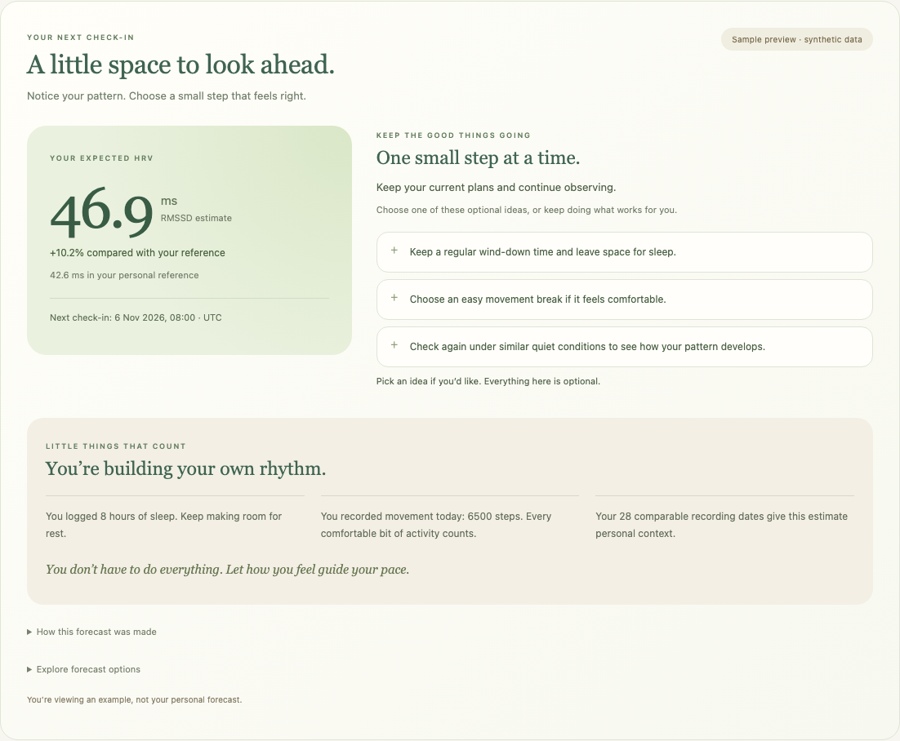
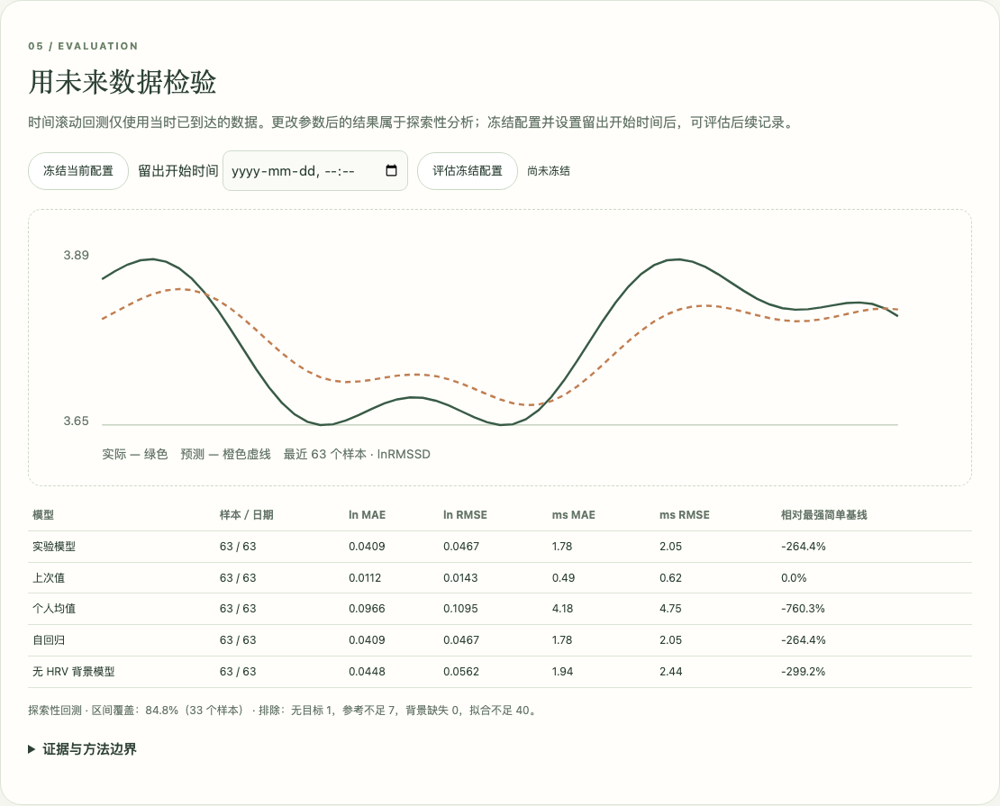

# MOND HRV prediction model and interaction guide

**Version:** engine `mond-lab-1.1.0` · **Prepared:** 5 November 2026  
**Audience:** product demonstrators, researchers and testers.  
**Purpose:** explain the current prototype and demonstrate its actual behavior. The model is an experimental personal forecast, with configurable assumptions and no prospective device validation.

## 1. Open the two views

| View | Hosted | Local |
|---|---|---|
| User-facing app | [App forecast](https://mond-hrv-prediction-lab.muxueqianxun.chatgpt.site/app.html#user-prediction) | [App forecast](http://localhost:8000/index.html#user-prediction) |
| Prediction lab | [Lab](https://mond-hrv-prediction-lab.muxueqianxun.chatgpt.site/) | [Lab](http://localhost:8000/prediction-lab.html) |

The hosted Site is private to its owner account. Sign in with the same account on another device. Localhost refers to the computer running the server. To start it from this repository:

```sh
python3 -m http.server 8000 --bind 127.0.0.1
```

Use the same origin when moving between app and lab. Hosted pages share storage with each other, and local pages share storage with each other. Hosted and localhost storage are separate.

## 2. User-side demonstration

Scroll on the home screen to the prediction section immediately after **Personal Context**. There is no dedicated Predictions shortcut.



1. The app initially shows a **synthetic sample forecast**, visibly labeled. It does not load personal data automatically.
2. Read the expected RMSSD, forecast time and comparison with the personal reference. The sample is deliberately positive: approximately **46.9 ms**, versus **42.6 ms** in the reference, or **+10.2%**. These are demonstration values, not results from a participant study.
3. Read the suggestions next to the estimate. Select an idea using its plus button. A check mark means a temporary intention in this page. Click again to deselect.
4. Review **Little things that count**, which acknowledges explicitly recorded sleep, movement and recording history. The screen does not establish that these behaviors caused the forecast.
5. Expand **How this forecast was made** for input quality labels, background, cycle applicability, version and limitations.
6. Expand **Explore forecast options** to show the sample again, load an explicitly saved experiment, or open the prediction lab.

**Important interaction distinction:** selecting a suggestion does not recalculate HRV, record action completion, train a policy, or persist a feedback event. The current UI keeps this choice in memory only. The model does not predict an HRV improvement from carrying out that suggestion. A higher HRV estimate is not automatically better health.

## 3. A five-minute lab walkthrough


### A. Load and run

1. Open the lab and select **载入合成示例** (Load synthetic sample).
2. Select **运行预测与回测** (Run prediction and backtest).
3. Inspect **预测与观察** (Forecast and observation). Compare experimental prediction, last value, personal mean, autoregression and background-only model.
4. Inspect **用未来数据检验** (Evaluation). The plot and error table describe a chronological retrospective experiment on the imported data. The synthetic example demonstrates functionality only.

### B. Change an assumption

1. Leave the same dataset loaded. Enable the sleep feature if necessary.
2. Save the current configuration using **保存当前配置为 A**.
3. Change the sleep coefficient from `0` to `0.05` and leave the input field so the change event applies.
4. Select **运行当前配置为 B**.
5. Inspect the difference and contributions. `0.05` is a deliberately chosen sensitivity-test value, **not a literature-derived effect**. The sign of the result also depends on whether current sleep is above or below its reference. It may decrease rather than increase the estimate.
6. Restore the coefficient to `0` or select **恢复参数默认值**. Defaults can change eligibility and user/device selection, so inspect them before rerunning.

A/B comparison requires identical records. If records change, save A again. Comparing configurations is model sensitivity analysis, not a randomized trial of sleep or other actions.

### C. Fit from history

Select **用历史拟合系数** (Fit coefficients). The lab fits background coefficients from the current user's eligible past data while keeping the chosen time constant fixed. If the date gates fail, it reports the reason instead of inventing weights. During backtesting, a fitted configuration refits at each historical origin using information available then.

### D. Save and show the result in the app

1. Run the lab after your final edits.
2. Select **保存到此浏览器** (Save to this browser).
3. Open the app on the same origin.
4. Expand **Explore forecast options** and select **Use my saved prediction**.
5. Check the saved target time and calculation time. This is a snapshot, not a new live prediction or automatic sensor integration.

### E. Move to another device

Select **导出完整实验包** to download JSON. On the other device, use **导入 CSV / JSON** in the lab, run it, then explicitly save to that browser if needed. The package includes sensitive records and cycle logs when present. Account sign-in does not synchronize browser-local experiment data.

## 4. Input data and comparability

The lab receives already calculated RMSSD and supplied quality flags. It does not process raw PPG or verify skin contact. PPG-derived variability remains PRV in provenance and is not assumed interchangeable with ECG HRV.

CSV uses one event per row. JSON can be a record array or a complete exported experiment package. Download the in-app template for exact current columns.

| Event | Core fields |
|---|---|
| Measurement | `id`, `type=measurement`, `user`, `time`, `arrival`, `timezone`, `modality`, `device`, `algorithm`, `duration`, `posture`, `breathing`, `quality`, `rmssd` |
| Background | `id`, `type=context`, `user`, `start`, `time` (end), `arrival`, `timezone`, optional `source` and context values |

Use offset-bearing ISO timestamps, such as `2026-11-05T08:00:00Z`, and IANA timezones, such as `Europe/Stockholm`. Arrival time is when the information became usable, not merely when the physiological event occurred. Background values: `sleep` hours, `activity` steps, `rhr` bpm, `energy` and `fatigue` integer scores 1–5, `work` and `diet` optional 0/1 logs. A blank value means unknown, not zero.

Default personal-reference rules:

- Most recent 28 days, excluding the current local date.
- Same user, modality, device, algorithm, duration, posture, breathing and accepted quality label.
- Local clock time within ±2 hours. Historical records retain their own local timezone context.
- Average log RMSSD within each date, then average dates equally. Repeated measurements on one day do not dominate the reference.
- At least 7 distinct dates for initial comparison and 14 for the more mature label. These are adjustable engineering settings, not proof of validity.

Changing device or context can leave insufficient comparable history. The page explains this; a manual reference is allowed for an explicitly hypothetical scenario.

## 5. Numerical model

Let `y = ln(RMSSD_ms)` and let `μ` be the personal reference on that scale. The core forecast is:

```text
ŷ(target) = μ
          + exp(−Δhours / τhours) × (y_latest − μ)
          + Σ βj × (xj_at_origin − referencej)

displayed_RMSSD = exp(ŷ)
```

- `Δhours` runs from the **latest eligible measurement** to the target, so a long gap reduces the contribution of that measurement.
- `τhours` controls persistence and defaults to 48 hours.
- The default horizon is 24 hours after the chosen prediction origin. The UI displays the exact target time and elapsed hours; a 24-hour interval can cross daylight-saving changes.
- Features are sleep, activity, resting heart rate and optionally a recorded cycle-phase indicator.
- Feature references can be manually supplied or estimated from past daily background averages.
- Coefficients start at zero. Disabled features contribute nothing. A missing enabled feature prevents the full experimental prediction and allows available simpler comparisons.
- Exponentiation gives a median-form estimate under a log-scale model. It is not an arithmetic-mean forecast or evidence of calibration.

For the synthetic user example, `μ` corresponds to about 42.6 ms, the latest reading is 50 ms and `exp(−24/48)` is about 0.607. Background coefficients are zero, so the forecast is about 46.9 ms. Sleep and activity are shown as context, not as the source of that increase.

### Settings reference

| Control | Default | Interaction meaning |
|---|---|---|
| User, timezone and origin | User `demo`, browser timezone, explicit ISO origin | Choose the person and information cutoff |
| Forecast horizon | 24 hours | Target offset from prediction origin |
| Reference window | 28 days | Historical reference and context-centering window |
| Clock / target tolerance | ±2 / ±2 hours | Comparable local timing / actual target matching |
| Initial / mature dates | 7 / 14 | Reference display gates |
| Time constant `τ` | 48 hours | Larger values retain more of the recent deviation |
| Manual RMSSD reference | Blank | Override historical reference only for a stated scenario |
| Modality / device / algorithm | PPG / latest eligible device and algorithm when blank | Select a comparable measurement series |
| Duration / posture / breathing / quality | 120 s / seated / natural / good | Match accepted recording conditions and supplied quality label |
| Recent background window | 72 hours | Maximum age of background used at an origin |
| Feature flags / coefficients | Disabled / zero | Opt in to specific effects and set assumptions |
| Feature references | Blank | Automatically center using past daily context, or set explicitly |
| Ridge penalty | 1 | Regularizes fitted coefficients |
| Minimum fit dates / dates per parameter | 30 / 10 | Training gate `max(minFitDates, perParameter × parameter count)` |
| Minimum cycle phase dates / cycle IDs | 5 / 2 | Additional feasibility gates when cycle fitting is enabled |
| Residual dates / interval level | 30 / 0.90 | Evidence gate and nominal empirical interval level |
| Advice rules | Sleep <6 h, fatigue ≥4, work=1 | Editable conditions, priorities, text and evidence URL |

The sample-loading action enables sleep, activity and RHR while retaining zero coefficients. Loading a sample differs from resetting model defaults. The editable reference values are numerical inputs, not automatically supplied clinical norms.

### Fitting and comparison models

The experimental fit uses ridge regression for enabled background coefficients. Each training date has equal total weight. It holds the time constant and feature definitions fixed. Default minimum training coverage is `max(30, 10 × fitted parameter count)` dates.

Comparators are last value, personal log mean, the decay autoregression, and a separately fitted background model with an unpenalized intercept. The background comparator has no lagged HRV input; historical HRV is necessarily its supervised target. It uses the selected background features, or sleep/activity/RHR when none are enabled. When cycle context is enabled, an additional no-cycle ablation compares performance on the same scored samples.

## 6. Menstrual-cycle context

The model offers an optional personal covariate, with no universal cycle correction or automatic 28-day schedule.

| Field | Meaning |
|---|---|
| `cycleLuteal` | `0` known follicular phase, `1` known luteal phase, blank unknown |
| `cycleStatus` | `natural` for the currently supported feature; other/unknown contexts leave the phase feature missing |
| `cycleMethod` | `self_report`, `calendar`, `LH` or `hormone` |
| `cycleId` | User-provided identifier for the recorded cycle |

Calendar labels remain estimates. The feature uses phase information **already available at forecast origin** as a lagged predictor. It does not read the target day's eventual phase. Unknown phase is not follicular phase. A newer unknown or unsupported status prevents carrying forward an earlier known phase. Natural-cycle coefficients are not applied to hormonal contraception, pregnancy or menopause.

The cycle coefficient starts at zero and can be manually explored or personally fitted. Fitting additionally checks two phases, at least 5 recorded dates in each phase and at least 2 recorded cycle IDs by default. These configurable counts are feasibility gates, not a guarantee of adequate power, full cycle coverage or stable personal effects. Cycle phase does not automatically change lifestyle recommendations.

Evidence informs this design rather than providing pretrained weights:

- [Schmalenberger et al., 2019](https://pmc.ncbi.nlm.nih.gov/articles/PMC6912442/): 37-study meta-analysis of 1,004 participants found an average follicular-to-luteal cardiac vagal activity decrease. Its standardized effect is not a personal RMSSD percentage.
- [Wearable cardiovascular amplitude study, 2024](https://pmc.ncbi.nlm.nih.gov/articles/PMC11666598/): quantified RHR/RMSSD variation across 11,590 participants and 45,811 cycles. It describes wearable cycle fluctuation rather than validating this two-minute PPG forecaster.
- [Schaffarczyk et al., 2026](https://pubmed.ncbi.nlm.nih.gov/42012497/): ovulation-aligned cyclic mixed models found marked individual dynamics with a flat population lnRMSSD trajectory. Personal testing is therefore more appropriate than imposing one fixed cycle curve.

## 7. Backtesting and uncertainty



The engine orders origins by actual information availability. It constructs references, feature centering and fitted coefficients only from data available at each origin. A target is the closest eligible future measurement within ±2 hours of the planned target by default. A measurement cannot serve as a scored target twice. Missing targets stay missing.

All displayed model metrics use a common valid sample set. This means scoring can be sparse or empty when the background comparator cannot fit, even if a simpler model could produce a point prediction. Review the exclusion counts before comparing errors.

The lab reports MAE and RMSE in lnRMSSD and milliseconds, effective dates and relative error improvement. Empirical intervals use earlier, already available out-of-sample absolute residuals. The default gate is 30 residual dates. Coverage is evaluated on later outcomes. These intervals do not provide a guaranteed coverage level. The user-facing card currently does not expose an uncertainty interval.

A retrospective parameter change produces exploratory backtesting. Freeze the configuration and select a holdout origin no earlier than its actual freeze time to evaluate later records. Freezing does not undo prior inspection of data or replace a properly designed prospective study. Synthetic demonstrations cannot show predictive utility.

## 8. Suggestions, privacy and current limits

Suggestions use editable eligibility rules and user-supplied context independently of the numerical forecast. The user card also offers general optional ideas, encouragement and acknowledgments of logged behavior. It does not simulate an intervention. Default encouragement is deliberately neutral about health value and causality.

Data stays in page memory unless a user explicitly saves locally or exports it. The app reads a saved lab experiment only after an explicit action. Imported and exported packages include original input data, settings and results. Do not place private recordings in a public Git repository.

Current boundaries: no raw PPG verification, no prospectively trained population model, no clinical diagnosis, no validated individual cycle effect, no causal recommendation model, no automatic cloud sync, no durable intention/completion logging, and no automatic forecast from the native sensor stream.

## 9. Presenter run sheet

| Time | Action | Point to explain |
|---|---|---|
| 0:00–1:00 | Open user card | Synthetic positive example, expected HRV and personal comparison |
| 1:00–2:00 | Select an optional idea, expand explanation | Intentions are temporary; context does not establish causality |
| 2:00–3:30 | Open lab, load sample, run | Separate data, assumptions, forecast and evaluation |
| 3:30–5:00 | Save A, change coefficient, run B | Sensitivity rather than an action-effect prediction |
| 5:00–6:00 | Show fitting and backtest | Past-only training, common samples, missing targets and uncertainty |
| 6:00–7:00 | Explain optional cycle fields | Personal evidence, provenance and unknown phases |
| 7:00–8:00 | Save experiment, show in app, export | Same-origin storage, snapshot dates and cross-device transfer |

The exact UI, formula and gates are implemented in `prediction-lab/engine.js`, `prediction-lab/lab.js` and `prediction-lab/user-results.js`. Model code is on the `feature/hrv-prediction-test` branch. Recheck future versions before reusing this demonstration.
